# Neon Hub: Landing Pages, Headquarters, Lifestyle, Calendar, Journal, Street Cred & Style Check for Cyberpunk RED

Seven tools for **Cyberpunk RED - CORE** on Foundry VTT:

- **Hub pages.** Build a clickable landing-page scene in a visual editor. Each button is a
  [Monk's Active Tile Triggers](https://github.com/ironmonk88/monks-active-tiles) tile that takes
  players to a scene, opens a journal or character sheet, opens a Neon Market shop, the crew's
  Headquarters, Lifestyle, the calendar, Street Cred, Style Check or Night City Messenger, plays sound, shows an image or
  runs a macro.
- **Headquarters.** A crew HQ screen built on the *No Place Like Home* rules: HQ IP, the twelve
  Improvements and their Upgrades, the ten Morale Boost levels, rent and access, the Server Room's
  eurobuck cost, and a monthly Humanity roll.
- **Lifestyle.** Each character's rent and monthly expenses as equippable items: housing,
  lifestyle packages, memberships, health plans, screamsheets, transit, fuel, loans and
  furnishings, billed monthly through the wealth ledger, with compendiums of ready-made items
  and templates for your own.
- **Calendar.** Group calendars, one per crew, each with its own date and rent day. Passing rent
  day starts the month for that group's lifestyle bills and Headquarters, and every day shows the
  real Moon's phase. Downtime gives the crew time to spend, for other modules' downtime actions too.
- **Neon Journal.** Foundry's journals in Neon Hub's style, with a gig tracker (objectives,
  rewards and pay-outs), weekly screamsheets, worldbuilding with a 2070s Worldbook, a journal for
  each character, a story journal for sessions and events, and a log of every downtime.
- **Street Cred.** Each character's Reputation, Standing with the Free City's gangs, corps and
  Nomad families, Heat with the NCPD, and relationships, as the 2070s rules run them: joining a
  gang or corp at +4, rivals, cooling off, and what each Standing gets you.
- **Style Check.** Fashion analysis for 2070s Night City: a grade for each character's look, how it
  fits each of the eighteen districts, which faction it reads as and how good a disguise that makes,
  a shopping list, the street's comments, and a GM view of the whole scene, with a compendium of
  2070 fashion and the factions' colors and uniforms.
- **The 2070s Item Compendium.** Every weapon, ammo, attachment, armor, piece of cyberware, deck,
  program, drug and piece of gear in the *Cyberpunk: The Unification Era* Item Compendium as
  Cyberpunk RED items with Active Effects for their bonuses, its vehicles, ACPAs and cyberpets as
  actors ready for MMuton's vehicle sheet, and the 2070 Core Rules' range tables as DV tables.

**Neon Hub: Full Borg** is a companion module in the same repository, released with Neon Hub: the
Item Compendium's 2070 Full Body Conversions built on the sheet, and **Go Metal** to move a character
into one. See [Full Borg](#full-borg-its-own-module).

| Requirement | Version |
| --- | --- |
| Foundry VTT | v12 (built with v13+ APIs in mind, see below) |
| Cyberpunk RED - CORE | 0.92 (checked against the 0.92.4 source) |
| Monk's Active Tile Triggers | 12.02 or later (required) |
| Neon Market | optional, for shop buttons |
| [Night City Messenger](https://github.com/christinophrappuccino/night-city-messenger) | optional, for messenger buttons |
| Neon Combat Manager, Neon At Home | optional, for buttons that open their windows (the Night City Map, Holocall, Home, Perk Tree...) |
| [SmallTime](https://github.com/unsoluble/smalltime) | optional: 1.24.0 on Foundry v12, for the world clock in the calendar |
| [MMuton's CPR Vehicle Actor Sheet](https://github.com/MMuton/MMutons-Cyberpunk-Vehicle-Actor-Sheet) | optional: 2.6, for the 2070s vehicles and ACPAs |
| Neon Hub: Full Borg | optional, for the 2070s Full Body Conversions (its own module, same release) |

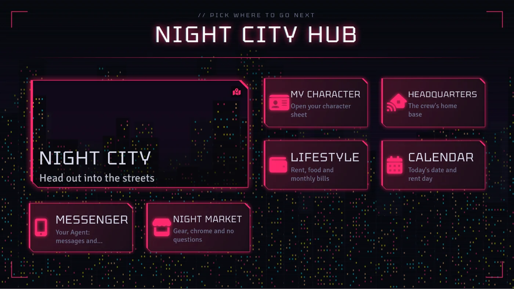

**One look.** Everything in Neon Hub shares the calendar's style: black chrome, notched corners,
`//` labels and the Tektur typeface. New hub pages, Headquarters and the Lifestyle window use the
**Night City chrome** theme; the other eight themes are still there for pages and HQs that suit
them (existing ones keep the theme they had).

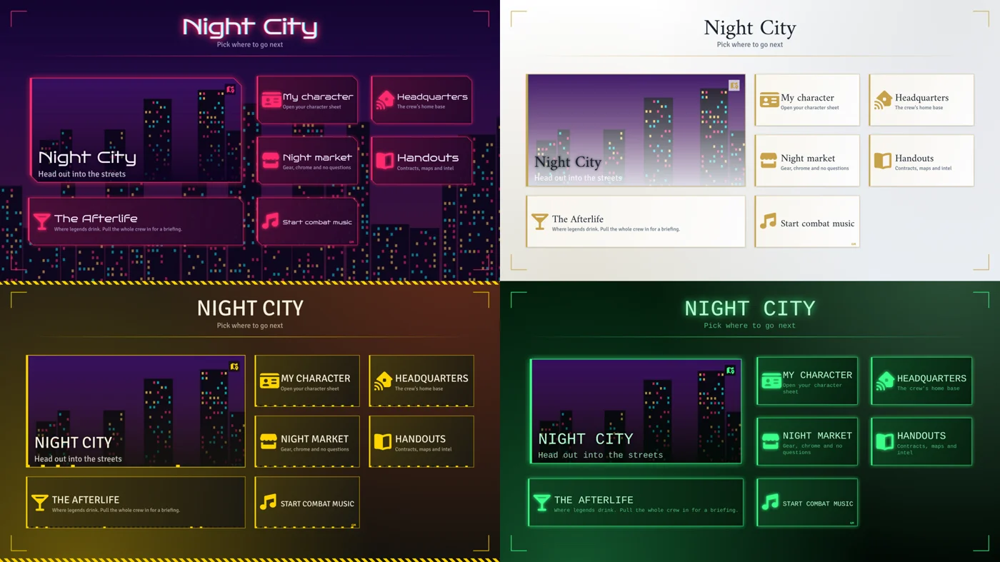

## Install

**From a manifest URL (recommended, gets automatic updates):** in Foundry's setup screen open
*Add-on Modules*, click *Install Module*, paste the manifest URL from this project's release page,
and click *Install*. See [PUBLISHING.md](PUBLISHING.md) for the URL format.

**By hand:** unzip `module.zip` into `Data/modules/cpr-neon-hub/`.

Enable **Neon Hub** and **Monk's Active Tile Triggers** in your world.

## Hub pages (GM)

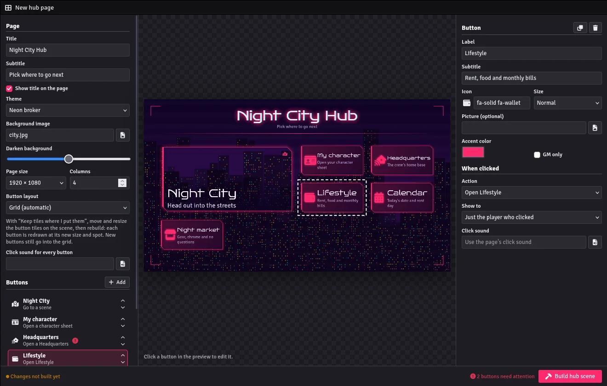

1. In the **Scenes** sidebar, click **New hub**. To edit an existing hub later, right-click its scene
   and choose **Edit hub page**.
2. Set the page on the left: title, theme, background art, page size and columns.
3. Add buttons. Drag a scene, journal, page, actor, playlist, track or macro onto the button list
   to make a button for it in one step, or click **Add** and fill it in on the right.
4. For each button, pick what happens **when clicked** and who sees it:

   | Action | What it does | Built with |
   | --- | --- | --- |
   | Go to a scene | Take the clicker there, pull everyone's view there, or make it the active scene | MATT `scene` |
   | Open a journal | A whole journal or one page, for the clicker or everyone | MATT `openjournal` |
   | Open a character sheet | A chosen actor, or **the clicking player's own character** | MATT `openactor` |
   | Open a Neon Market shop | Opens the shop on the clicker's screen | Neon Hub's own MATT action |
   | Open a Headquarters | Opens the crew HQ screen | Neon Hub's own MATT action |
   | Open Lifestyle | Opens each clicking player's own Lifestyle window (the GM gets the month overview) | Neon Hub's own MATT action |
   | Open calendar | Opens the calendar window for whoever it's shown to | Neon Hub's own MATT action |
   | Open Night City Messenger | Opens the clicker's Agent inbox, a new message or contacts; GM: Network Management, the Admin Panel or GM contacts | Neon Hub's own MATT action |
   | Open a Neon module window | Opens one of Neon Combat Manager's or Neon At Home's windows for the clicker: the Night City Map, Holocall, Home, Perk Tree and the rest ([below](#other-neon-modules-windows)) | Neon Hub's own MATT action |
   | Play a sound | For the clicker or everyone | MATT `playsound` |
   | Control a playlist | Play, stop, pause, next, previous | MATT `playlist` |
   | Show an image | Image popout with a caption | MATT `showimage` |
   | Run a macro | As the player who clicked, or as the GM | MATT `runmacro` |

5. Click **Build hub scene**. Neon Hub draws the page and every button as images, saves them to
   `worlds/<your world>/cpr-neon-hub/`, and creates one locked click tile per button. **Rebuild**
   after any change; the same tiles are updated, not duplicated.
6. Click **Make active scene** (or put it in navigation) so players land on it.

**Good to know**

- Players click buttons with the token layer selected, which is their default. A GM on the Tiles
  layer selects tiles instead of clicking them; switch to the token layer to test.
- Buttons work while the game is paused.
- **Hover.** The pointer turns into a hand over a working button, and the button lights up:
  inverted into its accent colour, with the second accent on its border (picture buttons get an
  accent wash). Each player sees only their own hover. Turn it off with **Light buttons up under
  the pointer** in the page settings. Pages built before 1.4.0 need one **Rebuild** to get it.
  Lighting up works from the token layer, like MATT's hover triggers. If a button doesn't light up,
  `game.modules.get("cpr-neon-hub").api.hoverStatus()` in the console lists the lit images loaded.

  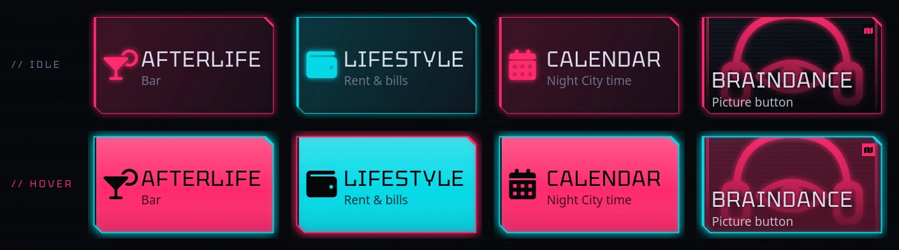

- **GM only** buttons are hidden from players and only respond to the GM.
- Want buttons in exact spots? Set **Button layout** to *Keep tiles where I put them* and rebuild
  once (the tiles unlock), move or resize them on the scene, then rebuild again. Each button is redrawn at its new size.
- The tiles are ordinary MATT tiles. You can open one with MATT's own editor and add more actions;
  rebuilding replaces the action list, so add extra steps after you're done with the hub editor.
- **Shop buttons** list every Neon Market shop: on actors in the Actors directory, and on unlinked
  tokens (a shop set up from a token's HUD belongs to that token), grouped by scene. Ones not yet
  ticked *Open for business* in Neon Market are marked *closed*, and the editor warns you, since players can't open
  a closed shop. Dropping a shop's actor anywhere on the editor (the button list or a button's drop
  zone) makes a shop button for it.
- Neon Hub's five actions also appear in MATT's own action list (group *Neon Hub*), so you can use
  them on any tile.

## Headquarters

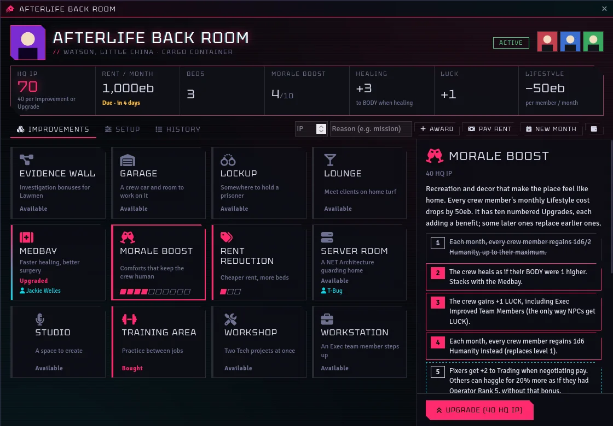

Open it from the **Headquarters** button in the **Actors** sidebar, a hub button, or a macro.

**GM setup:** click **New Headquarters**, then on **Setup** name it, choose a theme, set rent and
beds, and drag the crew's characters in. Players who own a crew character can open it. Tick
*Every player can open it* to show it to everyone. Use **Bookkeeping** to record Improvements a
crew already had before you installed the module (no HQ IP spent).

**Running it**

- **Award** HQ IP after missions. The DLC gives the crew HQ IP equal to the Group IP it earned.
- Every Improvement and Upgrade costs **40 HQ IP**. The Server Room also costs **20,000eb**, paid by
  one crew member or split evenly across the crew, through the Cyberpunk RED wealth ledger.
- **Players** see a **Propose** button instead of Buy. The GM gets a confirmation, because spending
  HQ IP is a crew decision.
- **Rent Reduction** can be upgraded once per original bed (it caps at double the beds).
  **Morale Boost** has ten levels; the screen shows which ones currently apply, since some
  replace earlier ones.
- **New month** rolls Morale Boost Humanity for each crew character (1d6/2, then 1d6 at level 4,
  then the higher of two 1d6 at level 9), adds it up to their maximum through the Humanity ledger,
  lets the system re-sync EMP, marks rent due and posts a summary to the crew.
- **Pay rent** takes it from one crew member or splits it. Paying rent on an HQ with no access
  restores access.
- Set **Access** to *No access* (benefits stop) or *Destroyed* (every Improvement is lost).
- The Garage, Server Room and Workstation each hold a link: drop the crew car, the NET
  Architecture or the Exec team member onto the panel.

The screen tracks and applies what can be automated (HQ IP, purchases, eurobucks, Humanity, rent).
Skill bonuses, LUCK, healing and the like are shown with the crew members who benefit, for the GM
and players to apply at the table.

**About the rules text.** Improvement and level descriptions are short summaries written for this
module. They are not the DLC's own wording. *No Place Like Home* (R. Talsorian Games, August 2024)
is free from R. Talsorian; check it for full details. To adjust a summary, edit `lang/en.json`
under `NEONHUB.Improvement` and `NEONHUB.Morale`.

## Lifestyle

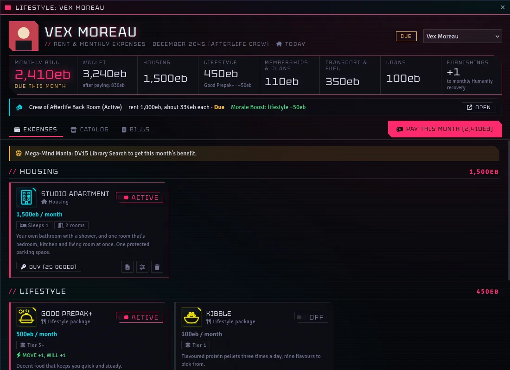

Rent, food and everything else a character pays for each month. Open it from the **Lifestyle**
button on a character sheet, in the **Actors** sidebar or on the Headquarters screen, or from a hub
button set to *Open Lifestyle*.

**How it works.** A lifestyle item is an ordinary Cyberpunk RED **gear** item with Neon Hub's
lifestyle settings. It shows in the gear tab like anything else.

- **Active means equipped.** Equipping the item, either with the switch in the Lifestyle window or
  CPR's own equip toggle, makes it active. Active items are billed each month and their Active
  Effects (stat and skill bonuses) apply, because their usage is *equipped*. Switch an item off to
  stop both without losing it.
- Only one **lifestyle package** is active at a time; switching one on switches the others off.
- **Quantity** multiplies the cost, e.g. fuel for two cars.
- Add items with the catalog's **Add** button, so loans pay out and furnishings are charged. An
  item dragged straight from the compendium onto a sheet arrives switched off and free; a car loan
  added that way does nothing until the GM sets its amount and months on its Lifestyle settings.

**The window**

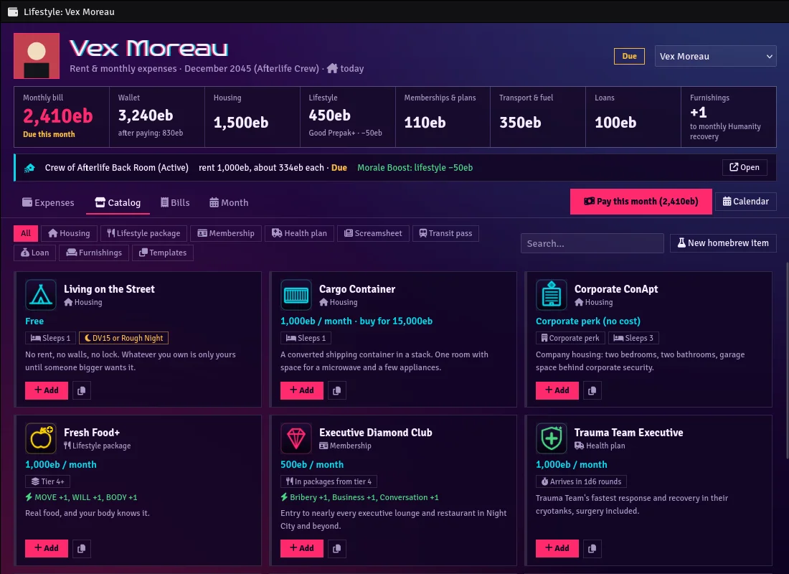

- **Expenses** lists the character's items by group, with the month's bill, wallet, what's left
  after paying, and reminders (rough nights, monthly checks). Items have their own buttons: **Buy**
  a rented home outright (no more rent), **Pay off** a loan, **Call it in** on a health plan (rolls
  the response time to chat).
- **Catalog** lists Neon Hub's lifestyle compendium plus any lifestyle items in the world's Items
  sidebar (homebrew). **Add** puts one on the character, active. Furnishings are paid for up front.
  Loans pay out their cash; a car loan asks for the vehicle's price, takes 10% down and sets 20
  monthly payments.
- **Bills** shows the character's last 24 bills.
- **Month** (GM) shows every player character's wallet, bill and status, with **Charge**,
  **Mark paid** and **Bill everyone due**. **New month** starts the next month. It can also charge
  everyone at once and start a new month at every Headquarters.

**Paying.** **Pay this month** charges the bill through the CPR wealth ledger and posts a receipt
to the owner and GM. Installment loans count down, and paid-off ones are removed. Bills can push a
wallet below zero (CPR allows negative eurobucks); the *Bills can put characters in debt* setting
turns that off.

**Who can do what.** Owners can always pay their bills, pay off loans, buy their home and roll
health plans. With *Players manage their own lifestyle* on (the default), they can also add,
switch and remove items. Otherwise, and for corporate perks or removing a loan, they send the GM a
request to confirm, like Headquarters purchases.

**With Headquarters**

- Crew of an active HQ with **Morale Boost** get its 50eb lifestyle discount on every bill.
- The window shows the HQ's rent and each member's share. Rent is still paid on the HQ screen.
- Active **furnishings** add their Humanity bonus (+1 to +3, best set only) to the HQ's monthly
  Morale Boost Humanity roll.

**Homebrew (GM)**

- **New homebrew item** in the catalog creates a world item in a *Neon Hub: Lifestyle homebrew*
  folder and opens its settings.
- The compendium's **Homebrew Templates** folder has a blank item per category; **Make a homebrew
  copy** copies one into the world.
- Any gear item's sheet has a **Lifestyle** header button: set its category, monthly cost and the
  category's details (sleeps, purchase price, Rough Night DV; package tier; response time; Humanity
  bonus; loan terms; a monthly check like *Library Search DV15*), or turn an item into a lifestyle
  item. Add bonuses on the item's Effects tab.

**Compendiums**

| Compendium | Contents |
| --- | --- |
| Neon Hub: Lifestyle | 11 homes (rents from the core rules, with purchase prices), the 4 core lifestyle packages and 4 "+" membership packages with stat bonuses, 7 memberships, 6 health plans, 7 screamsheets, 6 transit passes, 3 fuel tiers, 5 loans, 9 furniture sets, and 10 homebrew templates |
| Neon Hub: Street Goods & Lifepath | One-time items: 8 homebrew street drugs (Primary and Addiction effects), the Rough Night and Living the Good Life conditions, 15 food and livestock items, 5 home goods, and 8 Local Expert districts the core skill list doesn't have |

The numbers and rules come from the core rules and from the **Datapool: Lifestyles** homebrew
compendium by aru.guy and Henzard; the descriptions and icons are Neon Hub's own. Compared with
Datapool:

- Bonuses to Streetwise now apply (the original used a key CPR doesn't recognise).
- Smokestack's effects match its text (+2 / −1 COOL).
- Stardust's Performance Anxiety leaves out Play Instrument, which CPR splits into one skill per
  instrument.
- Core duplicates are left out: MRE, Kibble Pack, the Language skills and 13 of the Local Experts
  are already in Cyberpunk RED's own compendiums.

**With calendars.** Once the GM makes a calendar, it runs the months (see below): each character
is billed by their group's calendar, the window shows that month ("November 2045") and the days
to rent day, and a character who missed several rent days owes each month (up to 12). Without a
calendar, the GM starts months with **New month** as before.

### Households

A home several characters share. The GM sets one up on the **Households** tab of the Lifestyle
window: pick the home from the catalog (its rent can be changed), who lives there, and how the rent
is paid:
- **Split evenly**: each inhabitant's monthly bill carries an even share.
- **One character pays**: the payer's bill carries all of it; the others pay nothing for the home.
- **Pool until it's covered**: nobody's bill carries it; during the month anyone **chips in** from
  their own wallet until the rent is met (only what's still needed is taken). A new month starts an
  empty pool. Players chip in themselves; the GM sees each household's progress.

Each inhabitant's Lifestyle shows the household as their home, with its part of the rent. Owned
homes and corporate perks cost nothing. In the 2070s the home's houseware slots are shared: every
inhabitant's houseware fills them, and CyberBeds raise how many it sleeps. The home's Humanity tax,
credit and monthly roll apply to each inhabitant, while furnishings and art stay their own. Moving
in more people than the home sleeps asks before going ahead.

### The 2070s: Living & Humanity Rework

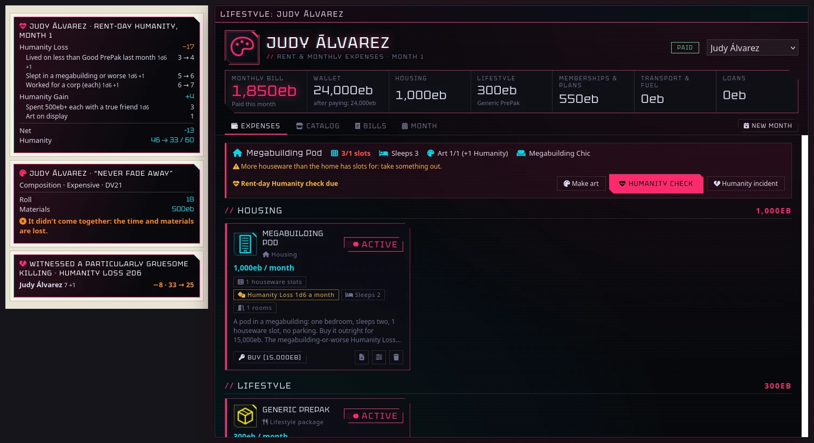

**Pick the era per campaign.** *Lifestyle era* in the module settings chooses between **2045
(Time of the Red)**, the catalog above and the default, and the **2070s**, built from a GM's
Living & Humanity Rework homebrew (a 2070s update of the Datapool lifestyles). The 2070s have their
own compendium, **Neon Hub: Lifestyle (2070s)**, which the catalog switches to, and these rules. The
numbers and mechanics are the homebrew's; the descriptions are Neon Hub's own.

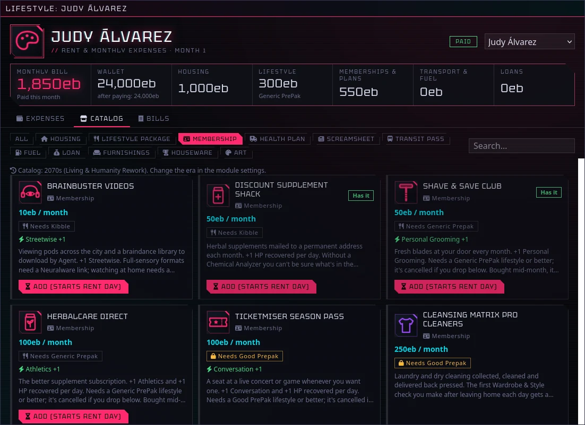

**The 2070s catalog (88 items).**
- **Lifestyle packages**: Kibble (100eb, −1 COOL and WILL), Generic PrePak (300eb), Good PrePak
  (600eb, +1 WILL, the full-body-conversion perks) and Fresh Food (1,500eb, +1 WILL, +1 maximum EMP).
- **Memberships and health plans by tier**, with their skill bonuses: BrainBuster and the Supplement
  Shack (Kibble), HerbalCare, Shave & Save, Cryobank and REO Meatsavers (Generic PrePak),
  TicketMiser, Cleansing Matrix and Trauma Team Silver (Good PrePak), Mallbuster, the Diamond Club
  and Trauma Team Executive (Fresh Food), Corpo-Care Gold and Platinum, and the corporate housemate fee.
  Health plans and cabs roll their arrival with **Call it in**.
- **Transit**: the bus, NCART, NCab, North Oak Express, CombatCab, Delamain Ground and SkyRider,
  and the lifetime Delamain Excelsior (20,000eb once); **fuel** for bikes, cars, AVs and boats;
  Insider Trading Today; loan sharks and bank loans (bank loans need Good PrePak).
- **Real estate**: from living on the street to a North Oak McMansion, with rent or purchase price,
  bedrooms, how many it sleeps, parking, **houseware slots** and its Humanity tax or credit, plus
  Living in a Ship.
- **Furnishings** (bought per room): the nine megabuilding, apartment and North Oak sets, with their
  quality and their modifiers to Humanity Loss and Gain rolls.
- **Houseware**: the Augmented Reality Art Display, the Double-Trouble CyberBed, the Drinks Globe,
  the Auto Barista, both showers, soundproofing, the SmartOven and the Virtual Barbeque, each taking
  slots. **Art pieces** at each quality, and therapy and Immunoblockers for reference.

**Rent day.** When a character pays the month:
- Memberships bought after the last bill start now (until then they show *Starts on rent day*),
  and memberships the lifestyle no longer covers are cancelled. Players can't take a membership
  above their lifestyle; the GM can.
- The month's **environmental Humanity check** comes due. The GM opens it from the character's
  Lifestyle window or the month table: what their package, home, furnishings and displayed art
  bring is filled in, and the GM ticks the rest (worked for a corp, deaths, a loved one, a week off,
  a true friend…). One click rolls it all, adds the furnishings' modifiers, the Humanity tax or
  credit and the art, adds Living the good life when it applies, and applies the net change through
  the Humanity ledger with a chat card. Gains stop at maximum Humanity; losses can reach Cyberpsychosis.
- What comes automatically: Kibble is a 2 Humanity tax plus the 1d6 for living below Good PrePak;
  Generic PrePak is the 1d6; Fresh Food a 2d6 gain. Homes add their tax or credit and roll: the
  megabuilding-or-worse 1d6 (2d6 in a vehicle), the upscale 2d6 gain, and for a ship the 1d6 for
  time outside the city too. Living on the street is a 6 tax and the 1d6; the 3d6 for living rough
  is the GM's tick, for when it fits what happened.
- **Three weeks in a home.** A home's Humanity tax and credit only count after 21 days there; any
  time on the street or in a vehicle that month, that tax applies instead. Neon Hub dates each
  move-in on the character's calendar (adding or switching on a home, or joining a household), and
  the check's *Living-space tax this month* starts on "None: under three weeks" when the dates say
  so, else on the home's. The GM can pick the street, a vehicle or an upgraded vehicle instead. The
  rolls follow where they live either way, and Kibble's tax always applies. Without calendars (or
  for homes from before this was added) it starts on the home's.

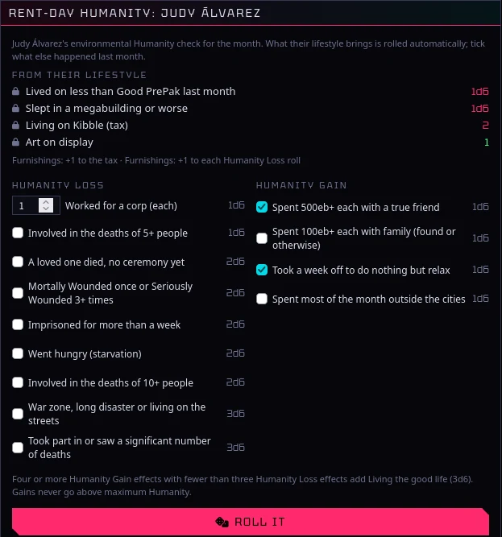

**Humanity incidents.** *Humanity incident* rolls the one-time Humanity Loss and Gain table (or
custom dice) for any characters, furnishing modifiers included, partying included.

**The home and art.** The Lifestyle window shows the home's houseware slots used, how many it
sleeps, the furnishings, and the art on display. Each piece of art needs its own ARAD, a home shows
no more pieces than it sleeps (a CyberBed's extra sleeper doesn't count), and a piece only counts in
a room furnished at its quality or finer. Second-hand furnishings allow no upgrades at all.
**Make art** spends the materials for a quality, rolls the art skill (Paint/Draw/Sculpt, Composition,
Photography/Film, Play Instrument or Acting) against its DV, and on a success adds the piece, worth 1
to 4+ Humanity a month on display. Music and acting can be performed too: the second skill's roll adds
the quality it reaches.

**Data.** Item settings live in `flags.cpr-neon-hub.lifestyle`, a character's bills in
`flags.cpr-neon-hub.lifestyleState`, and the month in a world setting. Neon Hub also mirrors
active housing, lifestyle package and health plans into the actor's `system.lifestyle.housing`,
`lifeStyle` and `traumaTeam` fields (part of CPR's data model, not shown on the 0.92 sheet).

## Calendar

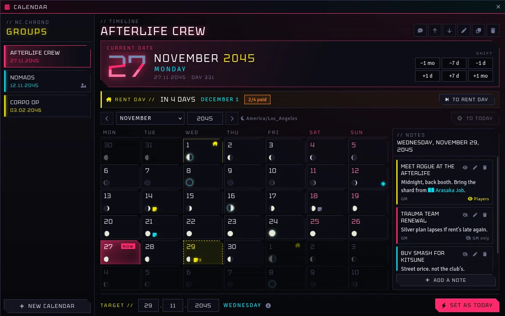

Open it from the calendar button in the left toolbar (Token Controls), a hub button set to *Open
calendar*, or the Lifestyle window. It works with no scene on the canvas.

**Month in its own window.** The pop-out button beside the month picker moves the month grid into
a window of its own, leaving the calendar window to the date, time, rent, forecast and notes.
Popped out, days have room to name their weather. Both windows stay in step: pick a day in the
month to read its notes in the calendar, and the GM can still double-click a day to set the date.
Close the month window (or **Back into the calendar**) to dock it again; it remembers your choice.

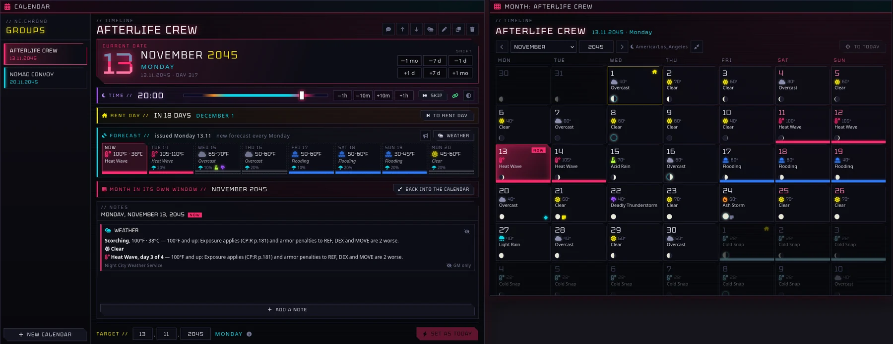

**Calendars per group.** The GM makes a calendar for each group of edgerunners, with its own
name, color, date, rent day and players. Players see the calendars open to them (no players ticked
means everyone) and can page through months, but only the GM changes dates. A **yours** tag marks a
player's own group, and colored diamonds on the grid show where the other calendars are.

**Setting the date (GM).**
- **±1 d, ±7 d, ±1 mo** move the date.
- Click a day to target it, then **Set as today**; double-click a day to set it at once; or type
  the date in the **Target** fields.
- **To rent day** jumps to the next rent day.
- The speech-bubble button posts the date to chat (whispered to the group if it has players).
- Players get a notice when the GM changes a calendar they can see.

**Notes.** Click a day to open its notes beside the grid. Anyone who can see the calendar can
write notes there, Simple Calendar style:

- The GM's notes are hidden from players until **Visible to players** is on.
- A player's notes are private to them (and the GM) until they tick **Share with my group**,
  which shows them to everyone who can see that calendar.
- The GM sees, edits and deletes every note; players edit their own. The eye button shows or
  hides a note in one click.
- Days with notes are marked on the grid: yellow for shared, cyan for private, grey for the GM's
  hidden ones. Drag a journal, actor or item into a note to link it.
- Player notes are saved on the player's own user, so they can write them without a GM online.
- Hiding is done in the interface. Foundry sends world settings and user data to every client,
  so a player reading the game data directly could find a hidden note; keep real secrets elsewhere.

**Rent day.** Each calendar has a rent day (the 1st by default; a day later than the month has
falls on its last day). The window counts down to it and marks it on the grid. Players see whether
their characters have paid, and the GM sees how many have. When the GM moves a calendar past
its rent day:

- A new month begins for every character on that calendar (their player is on it, or it's the
  first calendar): lifestyle bills become due. Turn on *Charge bills automatically on rent day* to
  charge them at once.
- Every Headquarters on that calendar rolls its new month (Morale Boost Humanity, rent due). Pick
  an HQ's calendar on its Setup tab; by default it follows its crew.
- A rent-day notice goes to the group's chat.
- Jumping past several rent days asks first: **Start N months** (bills for each month, HQ months
  for each) or **Just move the date** (a time skip: nobody owes for the skipped months).

**The Moon.** Every day shows the real Moon's phase, computed with the full method of Jean Meeus,
*Astronomical Algorithms* (chapter 49), which places new, first quarter, full and last quarter moons
to within a minute or two. Those four phases glow on the day they happen; hover for the name and
time. Days are counted in Night City's time zone (`America/Los_Angeles`), which decides the day a
phase lands on. Change it in the *Calendar time zone* setting. Each player can hide the moon in
their own settings.

**Time of day, with SmallTime.** With [SmallTime](https://github.com/unsoluble/smalltime)
enabled (1.24.0, its last release for Foundry v12; later ones need v13), the calendar runs on the
world clock that SmallTime shows:

- **Days follow the clock.** Each time the world clock passes midnight, every calendar that moves
  with the clock goes on a day, with rent days, bills and HQ months as usual. It doesn't matter what
  moved the clock: SmallTime's buttons, the calendar's, a macro or combat rounds. Going back past
  midnight moves the calendars back. A calendar's own **±1 d / ±7 d / ±1 mo** buttons still change
  only that calendar and leave the clock alone, so groups can be on different dates.
- **Moves with the world clock** is on for every calendar; untick it in the calendar's settings
  (the pen button) for one that should stay put, like a flashback. A link icon on the time strip
  shows which way it's set.
- **Time controls in the calendar (GM).** The time strip shows the time and has SmallTime's step
  buttons (its *small* and *large step* settings), a slider for the time of day (night, dawn, day
  and dusk along it, from SmallTime's sunrise and sunset), and a button that shows or hides
  SmallTime's own window. These move the same world clock, so SmallTime's window and its darkness
  link follow along. The slider stays on the same day; step past midnight to change the day.
- Players see the time when SmallTime lets them see its clock in that scene.
- **Skip time** (GM, the **Skip** button on the time strip) opens a Cyberpunk 2077-style window
  on everyone's screen. Players drag the hand around a 24-hour dial to how long they'd skip and
  vote; everyone sees the votes and the **group's call** (the median vote, so one wild vote can't
  drag it). The GM uses the call, any one vote, or sets the dial, then **Skip**: every screen winds
  the clock through it, with the sky over a Night City skyline going from day to night and back,
  the sun and moon rising and setting, and each sunrise, sunset, moonrise, moonset and midnight
  called out as it passes. The world clock moves on at the end, so calendars change day as usual.
  Sun times come from SmallTime's sunrise and sunset; the moon rises with the sun when new and at
  sunset when full, about 50 minutes later each day, using its real phase. **Call it off** closes
  it for everyone. Up to 24 hours at a time.

  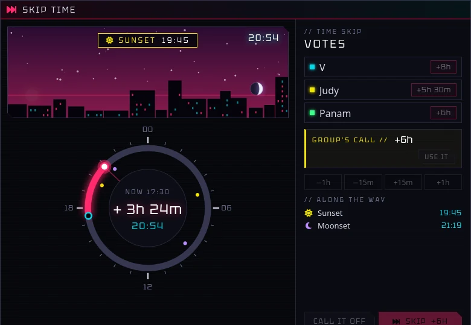

- **SmallTime's moon** is set to the real Moon's phase on the date of the first calendar that moves
  with the clock, which also drives SmallTime's moonlight darkness. Turn off *SmallTime shows the
  real Moon* to set it by hand in SmallTime.

**Downtime.** The GM calls a stretch of downtime and each character taking part gets that much
time to spend on downtime actions, from a pool of days, hours and minutes. Neon Hub keeps the
books; what the time is spent on (healing, crafting, gigs, a module's own downtime actions) is up
to the table and to other modules, which spend it through the API.

- **Calling it (GM).** The mug button in the calendar's header opens **Downtime**. **Call
  downtime** picks who takes part, a name for it ("After the Arasaka job") and either a set amount
  in days, hours and minutes, or **put it to a vote**: like Skip time, players propose an amount
  (1 day, 3 days, a week, two weeks, a month, or their own), everyone sees the votes and the
  group's call, and the GM starts it with the call, a vote or their own number. A card goes to
  chat with the total and who's in it, and Downtime opens for the GM and the players taking part.
- **Spending it.** Each character's card shows the time left and spent and their log, each entry
  placed on their calendar ("Mar 14–16") in the order it was spent. **Log downtime** spends time
  by hand; other modules spend it for their own actions. Players can take back what they logged
  by hand; the GM can take back anything. Players see only their own characters.
- **Everyone's spent.** When the last character's time runs out, the GM gets a full-screen alert
  and a whispered card. The GM reviews the log, then **Complete downtime**: a card sums it up
  (with any time left unused), and the Skip time clock opens on every screen and winds through
  the whole downtime on its own, counting the days (over three days, the sky plays the first and
  last day and holds still in between rather than flickering). The world clock moves on at the end
  and calendars change day with it. **Call it off** ends it without passing any time. Past downtime is listed
  under *Earlier downtime*.

**Night City weather.** Weather from R. Talsorian's free **Night City Weather** for Cyberpunk RED.
Neon Hub uses its dice tables; the rules summaries are Neon Hub's own short versions, with core
rulebook pages.

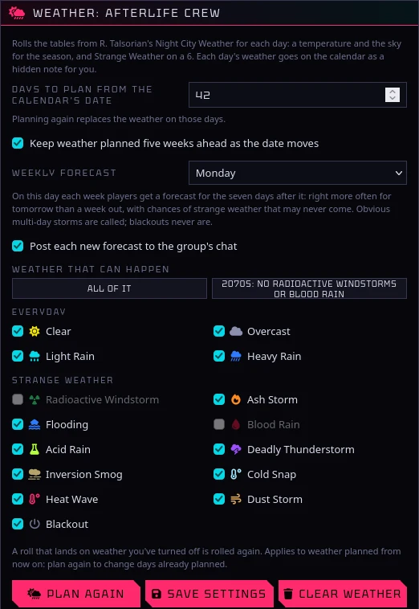

- **Planning (GM).** The cloud button on a calendar (or **Weather** on its forecast strip) plans
  days ahead from the calendar's date. Each day rolls a temperature and a sky (Clear, Overcast,
  Light or Heavy Rain, sleet when it's cold) on the season's table, and a 6 goes to Strange Weather
  with its duration: short events (acid rain for 3 hours from about 14:00) or ones that last days
  (flooding, inversion smog, cold snaps, heat waves, blackouts), which carry on across the days
  and set the temperature for cold snaps and heat waves. *Keep weather planned five weeks ahead*
  extends it as the date moves.
- **Weather you don't want.** Untick any condition and rolls that land on it are rolled again. The
  **2070s** preset turns off radioactive windstorms and blood rain.
- **Notes.** Each day's weather appears as a hidden note on that day for the GM, with how the
  temperature and conditions play at the table. The eye button reveals it to players.
- **The calendar.** Days show their weather beside the date, and multi-day events run as a coloured
  band along the days they cover. The GM sees the real weather; players see what they'd know:
  past days and today as they were, and the forecast (dashed, with temperature ranges) for the
  days ahead.
- **The weekly forecast.** On the calendar's forecast day (Monday by default) players get a
  forecast for the next seven days, posted to the group's chat too. It's usually right about
  tomorrow and close to a coin flip a week out, temperatures come as ranges that widen with
  distance, and short strange weather shows only as a chance ("Acid Rain possible: 30%") that can
  be missed or a false alarm. Obvious multi-day storms are called; blackouts never are. Players
  find out for sure on the day: the forecast strip shows today's real weather.

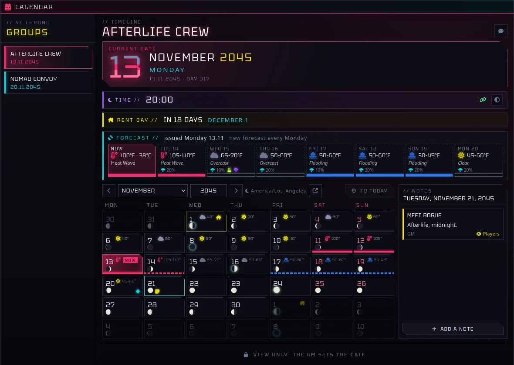

**Settings.** *Calendar time zone* and *SmallTime shows the real Moon* (world). *First day of the
week*, *Show moon phases* and *Notify on date change* (per player).

The calendar's layout and look follow Vokashu's **Cyberpunk Calendar** module, rebuilt for Neon
Hub; none of its code is used. The Tektur font is © 2023 The Tektur Project Authors, under the SIL
Open Font License 1.1 (`fonts/Tektur-OFL.txt`).

## Neon Journal

Every journal in the world, in one window in Neon Hub's style. With *Open journals in the Neon
Journal* on (a per-player setting, on by default), opening any journal (from the Journal tab,
a link, or the GM's **Show to players**) opens it here; the **Neon Journal** button on the Journal
tab opens it any time. The book button on an entry opens it in Foundry's own journal.

- **Sections.** *Journals* is every other journal, by folder. *Gigs*, *Screamsheets*,
  *Worldbuilding*, *Characters*, *Story & Events* and *Downtime Log* hold Neon Hub's own records,
  each filed in a folder of that name. Compendium journals still open in Foundry's own window. A search box
  filters the list, and Back and Forward step through what you've looked at.
- **Pages.** Text, image, video and PDF pages show in the window; links and inline rolls work as
  usual. Owners add pages and edit them in Foundry's page editor (the pencil).
- **For the GM.** On each entry: who can see it (the eye: all players, or only the GM), **Show
  to players**, permissions, rename and delete. The list marks entries no player can see.

**Gigs.** **New gig** makes one and opens its editor:

- The gig's name, an image (shown as a banner), client, location, deadline and danger, the crew
  taking it, and a briefing in the rich-text editor.
- **Objectives**, each open, done or failed. The gig shows them grouped (current, completed,
  failed) with a progress bar; the GM clicks an objective's box to move it along.
- **Rewards:** eddies (each, or split between the crew), IP each, HQ IP for a Headquarters, items
  and homes (drop them from the sidebar or a compendium), or anything else as a line of text.
- **Players can see this gig** decides whether players find it in their Gigs list.

The GM moves a gig along with **Take the gig**, **Completed**, **Failed** or **Reopen**, each
stamping the in-world date it happened. Once it's completed, **Pay out** asks who gets paid:
eddies go through the wealth ledger, IP through the Improvement Points ledger, HQ IP to the
Headquarters, items and homes to the character picked, and other rewards are marked as given. A
card goes to the crew in chat and the rewards show as paid. **Post to chat** sends the crew a
card with the gig's state and objectives and a link to open it (everyone, if players can see it).
The list filters gigs by Open, Found, Active, Done, Failed or All.

**Screamsheets.** A weekly paper for the crew, laid out like one: masthead, breaking news, news
in columns, developing stories, adverts and classifieds.

- **New issue** (GM) starts a draft numbered after the last one and dated today, with any
  developing story marked *Follow up* carried over as an update.
- **Roll stories** fills the issue from roll tables, a number of each kind. The **Neon Hub:
  Screamsheet Tables** compendium has starter tables (breaking news, city news, developing stories,
  adverts and classifieds, all original); **Generator tables** swaps in your own tables and sets how
  many stories each kind adds. A result reads `Headline | the story`; without a bar, a long
  result's first sentence is the headline.
- Write or change any story in the editor (the pencil): its kind, headline, text and byline.
- **Publish** lets players read the issue, posts a card with the headlines to chat, runs a
  breaking-news ticker across the top of everyone's screen (click it to read the issue), and, with
  **Night City Messenger**, sends each player character the headlines in their inbox (a world
  setting turns that off). Drafts are the GM's until published; **Send the alert again** repeats
  the card and ticker.

**Worldbuilding.** Entries for corporations, gangs, places, organizations, people and events. **New entry**
(GM) asks which kind and starts it from that kind's template: a line about it, facts to fill in
(a corporation's headquarters, industry and leadership; a gang's turf, rivals and hangouts; an event's
date, place and what it changed; and so on), and a write-up outlined with headings and a GM-only secrets block. Entries are GM-only until
**Players can read this** is ticked. Filter the list by kind.

- **The Worldbook (2070s).** The **Neon Hub: Worldbook (2070s)** compendium is an encyclopedia of
  Night City just after the Arvin Accord, in 178 entries: the megacorps and Danger Gal; the Old Three,
  the New Blood and the booster crews; all six boroughs and eighteen districts with their places,
  data blocks (Threat Rating, SC, UC, NCART, turf) and people; the NCPD, MaxTac, NetWatch, the Council
  and the nomad nations; the people who run the city, from Rogue and Mayor Rhyne to the Static Night
  crew, plus the Edgerunners crew (marked as spoilers); events from the Mob Wars to the Purge, Static
  Night and the Accord; and a timeline. Entries are written for Neon Hub from R. Talsorian's
  *Edgerunner's Handbook* (from the *Cyberpunk: Edgerunners Mission Kit*) and the *Night City 2070*
  setting book of *Cyberpunk: The Unification Era*, with their sources; anything a GM should keep
  back sits in a GM secrets block. **Import the Worldbook** copies them into the world, filed by kind
  and hidden from players, ready to edit.

**Characters.** A journal for each player character, theirs to write in. **Start a journal** makes
one (players for their own characters, the GM for anyone, or everyone at once); it belongs to the
character's players and the GM can read it. It opens on a **Profile**: handle, where they're from,
goals to tick off, contacts, and notes. **Log entry** adds a dated page for what happened, dated on
the character's calendar.

**Story & Events (GM).** **New chapter** starts a chapter of the campaign with an Overview page.
**Session** adds a session page, numbered after the last one, dated in-world and with today's
date, and with the player characters ticked: write what happened in the editor and list the key
events, starring the turning points. Chapters are the GM's own until shown to players.

**Downtime Log.** Each time the GM completes a downtime, its full record is filed here: the
total, the dates it ran, and each character's log with what they spent their time on and when,
as it stood at the end. Records are kept as they were and are GM-only until shown.

Neon Journal records are ordinary text pages with their data attached, and each keeps a
readable copy in its text, so they read fine in Foundry's own journal and without Neon Hub.

## Street Cred

Who knows you, who likes you and how hot the badge runs, by the *Street Cred* chapter of the
2070s rules. Open it from **Street Cred** at the top of the Actors sidebar, the **Cred** button on
a character sheet, or a hub button. The crew is down the left; each character has their
Reputation, Heat, and tabs for **Factions**, **Relationships** and a **Log** of every change. The
GM also gets a **Board**: every character against every faction at a glance.

**Reputation (0–10)** is the character's own CPR Reputation, so it's the same number the sheet and
its ledger show. The GM raises or lowers it with a reason that goes into the ledger. Anyone can
roll **Recognize** (someone new rolls 1d10: under the Reputation, they've heard of you) or a
**Facedown** (COOL + Reputation + 1d10) to chat.

**Standing (−10 to +10)** is kept per character and per faction, starting at 0. Each band says
what it gets you and what the faction's stores sell you, with the discount. The GM moves it with
**−** and **+**, by clicking along the bar, or with a **deed** (±1, ±2 or ±3, a reason, and
*enemies of my enemy*: tick the rivals that drop by 1). A character who moves into a new band gets
a whispered card (turn that off in the settings, or per deed); the GM always gets one.
- **Joining up.** At +4 a gang will jump them in and a corp will hire them: **Join** makes them a
  Ganger or an Exec, one gang or one corp at a time. If the character has a *Ganger* or *Exec* role
  item, its Rank follows their Standing. Below +4 they're patched out (or fired), with a card.
- **Cooling off.** Standing of +6 or better with no contact for three months (by the crew's
  calendar) shows **Cooling**: click it to take the 1. The handshake marks contact made today.
- **Factions.** It starts with the Players' Board: the Old Three and the New Blood gangs, the
  Scavengers (never above 0), the Aldecaldos and Wraiths, the Afterlife, the corps, MaxTac and
  Lazarus, each with its turf and rivals. The GM can add factions (booster crews, a Nomad family, a
  fixer's network), edit them, cap them, hide them from the players, or bring the Board back. A
  faction with a Worldbook entry of the same name (or the one named on it) links to it.

**Heat (−10 to +10)** is the NCPD's Standing, backwards: positive Heat is notorious, negative Heat is
goodwill. The bar and the card say what the badge does at each level.

**Relationships** are a character's people: an NPC actor, a Worldbook person, another character, or
just a name. Drop an actor or a journal entry onto the tab, or click **New relationship**. Each has
how they feel (−10 to +10, from Arch-Nemesis to Ride or Die), tags, notes and a romance heart. A
relationship with another player character can be **mutual**, kept the same on both sides. The GM
can **hide** one (the fixer who's quietly selling them out).

**Who sees what.** Players see their own characters; *players see the whole crew* in the module
settings shows them everyone's. Standing, Heat and Reputation are the GM's to change; *players edit
their relationships* lets them keep their own people. Hidden factions and relationships are only
ever shown to the GM.

## Style Check

How a character's look reads on the streets of 2070s Night City. Open it from **Style Check** at
the top of the Actors sidebar, the **Style** button on a character sheet, or a hub button. Pick
where they are (the scene's district by default) and the window shows how they fit there.

**The 2070 styles.** The *Item Compendium*'s six styles plus Gang Colors: **Entropism**, **Nomad
Leathers**, **Kitsch**, **Neo-Militarism**, **Neo-Kitsch**, **High Fashion** and **Gang Colors**.
Older clothing reads as its 2070 heir (Bag Lady Chic and Bohemian as Entropism; Generic Chic,
Leisurewear and Asia Pop as Kitsch; Urban Flash as Neo-Kitsch; Businesswear as Neo-Militarism).
CPR only knows its ten classic styles, so a 2070 piece is saved with the nearest classic one and
keeps its 2070 style in a Neon Hub flag: it stays a valid item with Neon Hub turned off. With the
*Lifestyle era* set to the 2070s, the sheet's style names show their heir ("Kitsch (Asia Pop)");
reload after changing the era.

**The compendium.** *Neon Hub: Fashion (2070s)* has a piece of every style for every slot (63) at
the *Item Compendium*'s prices, and 29 colors and uniforms that read as their faction: the Tyger
Claws' neon jacket and Kimen-Gumi mask, the Valentinos' Santa Muerte gold, 6th Street's surplus
patches, Maelstrom's red-optic visor, the Mox's very good boots, Barghest fatigues, Aldecaldo
family jackets, the corps' staff suits and the NCPD's uniform among them.

**Look.** What's worn in each slot and a score out of 100, from S to F: coverage (30), cohesion
(25), the pieces' quality (20), flair from fashionware (10) and Wardrobe & Style, Personal Grooming
and COOL (15). Top, bottoms, footwear and jewelry of one style make a **full look**. It also counts
what's in plain sight: drawn or unconcealable weapons, cyberlimbs, cybereyes and external chrome,
and body armor of SP 11 or more.

**Districts.** All eighteen districts and the Badlands, best fit first, from +10 (*Belongs*) to −10
(*Marked*), with a suggested modifier from +2 to −2 for social Checks with the locals and every
reason: the styles the district likes, your colors on your own turf (or a rival's), chrome shown
where it's hidden, weapons where security forbids them, too cheap for the towers or too rich for
the Combat Zone, and Street Cred (Standing with whoever runs it, Heat under a high Security Code).

**Factions & Disguise.** The factions a look reads as, and a disguise planner: pick one to pass as,
see how well the look holds (Convincing +2 to Hopeless), and roll it. The disguise check is a house
rule: COOL + Wardrobe & Style + 1d10 + the modifier against the watcher's INT + Human Perception +
1d10, +2 if they're one of them.

**Shopping.** Pick a district or a faction and a budget (the wallet by default): it lists the
pieces to buy, the faction's own first, then the cheapest of the right style, and shows the grade
and fit before and after. **Buy and wear** pays through the wealth ledger and puts them on; or drag
a piece onto a sheet.

**Street Feed.** What the street says about the look in that district, the same until the look
changes. **Post to chat** shares it.

**Scene (GM).** Set the scene's district, then see every token: player characters' grade, look,
fit and warnings; everyone else's look and the faction they read as, or the faction you tag them
with. It sums up the crew (how much they look like one crew, the weakest link) and flags
flashpoints: rival colors in front of that faction, a character Marked by someone in the room, or
Heat with a cop present.

**About the numbers.** The district dress codes, faction looks, scores and the disguise check are
Neon Hub's house rules built on the *Night City 2070* setting book and the *Item Compendium*.

## The 2070s Item Compendium

Three compendiums carry the *Cyberpunk: The Unification Era* Item Compendium into Foundry, built
from the book's own tables and text (its stats, its 2070 names and prices). Each item's footer names
the Item Compendium (2070) chapter it's from:

- **Neon Hub: Item Compendium (2070s)**, about 1,900 Cyberpunk RED items in the book's chapters:
  weapons (the 2070s catalog by class, generic weapons in three qualities and, for guns, as Power,
  Smart and Tech, variants and iconics),
  the Martial Arts Forms (each a Skill and a weapon to attack with),
  ammunition (one item per ammo kind, priced per 10 or each), explosives, grenades and the Thrown
  Weapon to throw them with, attachments,
  rebuilds and mods (weapon upgrades with their slots), armor (body and head SP and penalties),
  armor upgrades, shields, ACPA frames and shells, cyberware by system (install, Humanity Loss,
  foundations with their option slots, options with the slots they take), cyberware enhancements and
  operating systems, exotic packages, deep dive rigs, cyberdecks, cybersuites, hardware, quickhacks
  and vehicle quickhacks, programs, Black ICE, gear, holophone apps, drones, drugs, security systems,
  vehicle upgrades and ICE, bicycles and their upgrades, invented Tech Upgrades and street stock,
  and every vehicle as a vehicle item for character sheets. What's already in Neon Hub's Street
  Goods, Lifestyle (2070s) and Fashion (2070s) compendiums isn't repeated, and Full Body
  Conversions come in their own module ([Full Borg](#full-borg-its-own-module)). The FBC chrome
  itself (the Biosystem, coatings, plating, hydraulics) is here too.
- **Neon Hub: Vehicles, ACPAs & Cyberpets (2070s)**, 197 actors. Every vehicle in the 2070
  catalog, the bicycles and the iconic rides, and the six ACPA production models, set up for
  [MMuton's CPR Vehicle Actor Sheet](https://github.com/MMuton/MMutons-Cyberpunk-Vehicle-Actor-Sheet):
  SDP as HP, the vehicle's SP as an armor plate, MOVE, and crew seats from its seat count (a driver,
  cockpit or helm that moves the token, a gunner when it has onboard weapons, a passenger and the
  rest in the back), with bulletproof glass at 15 HP (30 for two installs). ACPAs have one pilot
  seat, with their onboard weapons mounted to it (each gun's attachments fitted, and a barrel or
  tube moving it to its new range table) and their cyberware installed. The eight cyberpets
  are mooks with their stats, HP and the rest in their notes. Without the vehicle sheet they open on
  CPR's mook sheet. Every actor has its own painted art on the sheet. The vehicles and ACPAs take a
  top-down token for the map, cut out on a clear background and sized by the ride (bikes and ACPAs
  one square, cars two, trucks, aircraft and boats three, ships and airships five); the cyberpets
  show their art in a token ring.
- **Neon Hub: DV Tables (2070s)**, the 2070 Standard range tables from the 2070 Core Rules (Chapter 07):
  Snubnose, Pistol and Long Barrel Pistol, Subcompact SMG and SMG, the three shotguns, Carbine,
  Assault, Battle, Marksman, Scout, Sniper and Anti-materiel Rifles, Shortbow, Bow and Longbow,
  Grenade, Rocket and Missile Launchers, and the Machine Pistol, SMG, Assault Rifle and Machine Gun
  Autofire tables. Every other table an autofire gun sits on has a "*table* (Autofire)" copy too
  (DV Carbine (Autofire) and the rest), the name CPR's Autofire switch looks for: pistols and
  shotguns copy Machine Pistol, the Subcompact SMG copies SMG, and the Carbine, Battle and Marksman
  Rifle copy Assault Rifle. They show in CPR's DV table list but aren't for giving a weapon. CPR's
  own table names are kept too (Bows & Crossbows, Long-Barrel Pistol, Shotgun (Slug), Thrown
  Weapon), so the system's weapons still find theirs. The first time the GM
  loads the world, Neon Hub offers to make them CPR's DV tables; switch any time in CPR's
  compendium settings or with `api.items.useDvTables(true|false)`.

**Range Table Modifications.** The book's barrels, chokes, limbs and tubes are one upgrade each, in
*Attachments & Mods › Range Table Modifications*: Snub Barrel and Long Barrel (Pistol), Short
Barrel (SMG), Short Barrel and Choke (Shotgun), Carbine, Battle and Marksman Barrel (Assault
Rifle), Scout Barrel and Long Barrel (Sniper Rifle), Short Limbs and Long Limbs (Bow), and Short,
Standard and Long Tube (Launcher). Install one in a weapon (the sheet, CPR's Install, or Neon At
Home's Weaponbench) and Neon Hub sets the weapon's own range table to the new one, keeping the old
table to put back when it comes out or is deleted: a Snub Barrel moves a pistol from DV Pistol to
DV Snubnose Pistol. CPR's attack and its Autofire switch, Diwako's DV display and Neon Combat
Manager's DV, Does it hit? and AA look all read that table, so they follow. The rules:

- **It has to fit.** A weapon on one of the family's tables takes it whatever its type, so Exotic
  Weapons can; a weapon with no table goes by its type. A Snub Barrel won't go in a sniper rifle.
- **One at a time.** Take the old one out before another goes in (in one go is fine).
- **Not with a Conversion Kit**, and not in the Magnum Opus Howitzer (the book bars it).

What doesn't fit is refused with a warning, and the rest of the install goes through. The new
tables are the 2070 ones, so use Neon Hub's DV Tables (2070s) as CPR's DV tables. CPR's own
Autofire switch finds the new table's "*table* (Autofire)" copy there, the family's Autofire table
(a Carbine Barrel keeps an assault rifle on Assault Rifle); Neon Combat Manager uses the Autofire
table the gun's card names.

The book's single *Range Table Modification* entry is still there under its old id, for worlds
that link it, but it changes nothing: installing it says to pick the option instead. Older copies
named after their option, like the ACPAs' "Range Table Modification (Scout Barrel)" from before
1.23.0, still work, and taking one out puts the gun back on its family's own table.
`api.items.rangeMods.check(weapon, upgrade)` says why an upgrade can't go in (or null).

**Autofire attachments.** The book's Autofire attachments change the gun too, in its own Autofire
rating and Suppressive Fire (what CPR's sheet, its damage roll and the Action HUD read) and in a
flag naming its Autofire table (`flags.cpr-neon-hub.autofireTable`, which Neon Combat Manager's DV
display and Does it hit? read first). Taking one out, or deleting it, puts the gun's own back.

- **Pistol Autosear** (any pistol that isn't slug-, shell- or arrow-only, Exotics on a pistol
  table too): Autofire (Machine Pistol 3) and Suppressive Fire, or Machine Pistol 4 on an Excellent
  pistol or one that already had Autofire.
- **SMG Cyclic Internals**, now two items, *(SMG 4)* and *(Machine Pistol 4)*, for a gun with
  Autofire (SMG 3). The book's entry keeps its id as the SMG 4 one.
- **Shotgun Automatic Control Group** (a gun that fires slugs or shells): Autofire (Machine Pistol
  3), or 4 if Excellent or already automatic. Its 4-slug bursts and the shell attack are its text.
- **Constant Recoil System** (assault-rifle Autofire): Machine Gun 3, or 4 on an Excellent gun.
- **Upsized Power**: +1 to the rating the gun ends up with, if it has Autofire.
- **Binary Trigger** and the **Electrothermal Enhancement (ETE)**: no Autofire or Suppressive
  Fire while they're in (the rating goes to 0, so CPR's sheet stops offering them).

**Rounds per burst.** Cyberpunk RED spends 10 rounds on every Autofire and Suppressive Fire attack.
Neon Hub changes that count for a gun whose attachments or card say otherwise, and CPR's ammo
check and the rounds it takes out of the magazine both use the new count:

- **Shotgun Automatic Control Group:** an Autofire burst of slugs spends 4. With shells, picking
  Autofire makes the book's shell attack: the Autofire Skill, 4 shells, and dodging it at −3. Neon
  Combat Manager rolls the shells' damage (not Autofire's 2d6 times a multiplier) and puts the −3
  on the Evade of everyone in the spread; without it, roll the shells' damage yourself.
- **Gatling Barrel:** double, for Autofire and Suppressive Fire.
- **Efficient Autosear:** an Autofire that spends 10 spends 6 (not on machine guns).
- **Superior Autosear:** an Autofire that spends 20 spends 10; more than 20 is halved.
- **Burst Governor:** 5 fewer for both, to no fewer than 5. It's a street Tech's Tech Upgrade
  (Street Stock, Hot, 1,000eb), now an upgrade in *Invented Tech › Street Stock* you install in the
  gun. It uses up the gun's one Tech Upgrade.
- **The Militech EX-75 IronWind, Mk. 31 HMG and Militiatech N32 Huge-Man-Gun** spend the 20 rounds
  their cards say.

In that order: the gun's own count, the slugs, the Gatling Barrel, the autosears, the governor.

One of the first four Autofire attachments at a time, one Upsized Power, and none the gun has built in already (a
card's *Built-in* line). CPR's own Autofire switch still picks its table by the range table's name,
so a Cyclic (Machine Pistol 4) SMG or a Constant Recoil rifle measures on the SMG or Assault Rifle
Autofire table there; Neon Combat Manager uses the right one.

**Active Effects.** Where the book gives a flat bonus or penalty, the item has a CPR Active Effect
for it, read from the item's own line ("+2 MOVE", "+2 Human Perception and Interrogation",
"COOL and TECH −2"). About 80 items have them, and they switch on the way CPR expects:

- **Cyberware** works while installed. **Gear, armor and weapons** work while equipped.
- **Drugs** work once you take a dose. **Booster programs** work while rezzed.
- **Upgrades** start switched off: turn them on in the item's Effects tab once they're fitted.
- **Bonuses you activate** (Speedware, a weapon's laser, timed boosts) are a separate effect named
  "(active)", off until you switch it on.
- **Conditional skill bonuses** ("+2 Perception for hearing") are situational. They show up as a
  checkbox when you roll that skill.
- **Linear Frames** set BODY to the frame's value unless yours is higher, and **Internal Hydraulics**
  set REF, DEX and MOVE to 4, 6 or 8 the same way. Both apply before other chrome's penalties, so
  Dragoon Plating's −2 still comes off.

Some lines are left in the text, for the GM to apply at the table:
- bonuses that depend on a condition and aren't skills;
- anything that works on someone else (quickhacks, Black ICE, a perfume's effect on others);
- armor penalties, which CPR applies itself;
- a weapon's bonuses to its own attacks.

Items are dragged into the world or onto sheets as usual. The vehicles' crew seats and glass can be
changed on the vehicle sheet's setup.

**Grenades.** As in Cyberpunk RED, a grenade is ammunition you throw with a **Thrown Weapon**
(Athletics with DEX, the DV Thrown Weapon table, one grenade loaded at a time): equip the Thrown
Weapon, load a grenade as you would a gun, and attack; the throw uses the grenade up. The grenades
are in *Ammo & Explosives › Grenades* with the Thrown Weapon, named the system's way
(*Grenade (Flashbang)*), with the system's damage settings (a Flashbang, Smoke or Sleep grenade does no
damage; Armor-Piercing and Incendiary throw for the Thrown Weapon's 6d6) and an icon of their own:
a red grenade with a hazard diamond showing its kind.

## Mook Pack

**Neon Hub: Mook Pack (Corgo's 77)** has ready-to-drop enemies as CPR mook actors, in a folder per
faction:

- **Corgo's 77 mooks**, 128 stat blocks from *Corgo's 77 Collection: Mooks* by Corgopolis
  (unofficial content under R. Talsorian Games' Homebrew Content Policy), across 20 factions from
  Maelstrom and the Tyger Claws to NCPD, MAX-TAC and Arasaka. Each has its STATs, Skills (COM# as the
  base of its unlisted attack Skills), armor, weapons from the Item Compendium (or a stand-in of the
  right class), gear and chrome installed, and notes for anything the catalog doesn't carry. Mooks
  with grenades carry a loaded Thrown Weapon. Descriptions are Neon Hub's own.
- **Drones**, the Item Compendium's 29 drones and defenses (robots, walkers, air drones and turrets):
  MOVE, HP, SP and CN from their entries, CN as the base of their attacks, Evasion and Perception,
  their weapons on the sheet (where a drone mounts a choice of guns, all of them, with a note), and
  a top-down token sized to the drone.

Every mook has a painted portrait; the Corgo mooks' tokens show it in a token ring. Tokens are
unlinked, so each one dropped is its own copy.

## Full Borg (its own module)

**Neon Hub: Full Borg** (`cpr-neon-full-borg`) brings the Item Compendium's *Full Body Conversions*
chapter to Foundry. It's a separate module in this repository's `full-borg/` folder that needs Neon Hub,
and every Neon Hub release ships it too. Install it from its own manifest URL:

`https://github.com/choccoops/neonredlanding/releases/latest/download/cpr-neon-full-borg.json`

- **Full Borg: Bodies (2070s)**: the book's 25 bodies as actors, by maker. Each one is built the
  way the book lists it:
  - the standard chassis, free in an FBC with its option slots doubled: Cyberarm ×2, Cyberaudio Suite,
    Cyberleg ×2, Cyberskull, an Internal Linear Frame and a Neuroport;
  - its eyes and base chrome, at no HL;
  - its chrome, each piece in the arm, leg, eye, ear, Neuroport or body slots it goes in, with
    enhancements and operating systems fitted.

  Open one to read the body on a CPR sheet.
- **Full Borg: Packages & Parts (2070s)**:
  - a package item for each body, with its price and Humanity Loss, to sell in a Neon Market shop;
  - the chassis parts, so a Tech can assemble a body;
  - the Biosystem;
  - Glucose-Rich Brain Solution, and a **Brain Starved** toggle (−2 to everything).

**Go Metal (GM).** Use the **Go Metal** button on a character or mook sheet, or drop a body package on
the sheet. Pick a body and choose how to take its Humanity Loss: roll it, take the average, or none.
Go Metal then:

1. Uninstalls the old chrome. It stays on the sheet, and the Biosystem stays installed.
2. Installs a Biosystem if there isn't one.
3. Creates the body's chrome, installed where the body has it, and doubles the Internal and External
   Body slots.
4. Rolls the package's Humanity Loss once, in the book's own dice (such as 17d6 plus half of 2d6, rounded
   up). CPR then sets the new Maximum Humanity:
   - the free chassis costs nothing;
   - other chrome is −2 a piece;
   - Borgware and the Biosystem are −4.
5. Sets BODY from the frame, with HP and Death Save following it. Hydraulics raise REF, DEX and MOVE.

**Switch bodies** takes out everything the old body put in. **Leave the body** leaves only the
Biosystem. The API is `game.modules.get("cpr-neon-full-borg").api`, with `open`, `goMetal`,
`leaveBody`, `isFBC`, `state` and `bodies`.

The rest of the FBC Baselines stay with the table (Core Rules (2070), Chapter 09):
- the injury and Wound State immunities;
- immunity to drugs and poison;
- brain food each month;
- repairs.

## Night City Messenger

[Night City Messenger](https://github.com/christinophrappuccino/night-city-messenger) by
christinophrappuccino (MIT) gives every character an Agent with messages, contacts and eurobuck
transfers, plus networks, data shards, terminals and hacking. It's a separate module with its own
look, its own updates and its own sounds; install it alongside Neon Hub to use it.

With both enabled, a hub button set to **Open Night City Messenger** opens one of its windows for
the player who clicks (or whoever the button shows to):

| Opens | Who |
| --- | --- |
| Inbox (the character's Agent) | everyone |
| New message | everyone |
| Contacts | everyone |
| Network Management | GM (players get their inbox) |
| Admin Panel | GM (players get their inbox) |
| GM contacts | GM (players get their inbox) |

The new starter hub page includes a **Messenger** button. Without Night City Messenger the button
does nothing but say so, and the hub editor warns about it.

## Other Neon modules' windows

Neon Combat Manager and Neon At Home each ship a **Macros** compendium, with one macro per window,
for the hotbar and Neon Combat Manager's Action HUD. A hub button set to **Open a Neon module
window** opens the same windows. It makes the same API call as the macro, on the clicking player's
screen, so nothing needs to be imported into the world. Character windows open for the player's
selected token's character, or their own.

| Module | Windows |
| --- | --- |
| Neon Combat Manager | **Night City Map**, Holocall, Biomon Link, Plot Die, Condition Lab (GM) |
| Neon At Home | Home, Loadout, Cyberdeck, Vehicle Bay, Weaponbench, Maintenance, Downtime, Biomonitor, Deep Dive, Perk Tree, Spend IP |

- **Monk's Active Tile Triggers.** The same action is in MATT's own action list as *Open a Neon
  module window* (`cpr-neon-hub.opencompanion`), for any tile, with MATT's usual "show to" choice.
- **The starter page.** Its **Night City** button opens the Night City Map when Neon Combat Manager is
  active. Without it, the button is a scene button to pick a map for. To point an existing page at
  the map, set the button to **Open a Neon module window: Night City Map** and **Rebuild**.
- Without the module, the button says so when clicked, and the hub editor warns about it.

**Neon Hub's own macros.** The **Neon Hub: Macros** compendium does the same for Neon Hub's windows,
for the hotbar or Neon Combat Manager's Action HUD (drop one on it):
- Lifestyle, Street Cred and Style Check, for the selected token's character or your own;
- Calendar, Headquarters (straight in, or a choice when there are several), Neon Journal and Downtime;
- for the GM, Skip Time and New Hub Page.

## Macros and API

```js
const hub = game.modules.get("cpr-neon-hub").api;
hub.editHub();                 // GM: open the editor for a new hub
hub.editHub(scene);            // GM: edit an existing hub scene (Scene or uuid)
await hub.rebuildHub(scene);   // GM: rebuild from the saved layout
hub.listHQs();                 // Headquarters this user can see
hub.openHQ(id);                // open one on this client
hub.showHQ(id);                // GM: open it on every connected player's screen
hub.chooseHQ();                // open the HQ this user can see, or pick one
hub.companions.open("cpr-neon-combat-manager/map"); // a Neon module's window here (list() names them all)
hub.companions.show("cpr-neon-at-home/perkTree");   // GM: on every connected player's screen
await hub.awardHQIP(id, 20, "Arasaka extraction"); // GM

hub.openLifestyle();           // your own character's Lifestyle window (or pass an Actor/uuid)
hub.showLifestyle();           // GM: open it on every connected player's screen
await hub.lifestyleBill(actor);   // { bill: { lines, groups, discount, total }, wallet, status, ... }
await hub.payLifestyle(actor);    // pay this month's bill
await hub.newLifestyleMonth({ hqs: true, bill: true }); // GM: next month, roll HQ months, bill everyone
await hub.billLifestyles();       // GM: charge everyone still due
hub.lifestyleMonth();             // the counter month (worlds without calendars)

hub.openCalendar();               // the calendar window on this client
hub.showCalendar();               // GM: open it on every connected player's screen
hub.listCalendars();              // calendars this user can see
hub.getDate("Afterlife Crew");    // { year, month, day } by id or name
await hub.setDate("Afterlife Crew", { year: 2045, month: 11, day: 1 }); // GM; { rent: false } skips billing
await hub.addDays("Afterlife Crew", 7);  // GM
await hub.toRentDay("Afterlife Crew");   // GM: jump to the next rent day
hub.dateToChat("Afterlife Crew");
hub.time();                       // world clock: { minutes, time: "21:47" }
await hub.advanceTime(90);        // GM: 90 minutes on; following calendars change day at midnight
await hub.setTime("06:00");       // GM: time of day, same day (or minutes after midnight)
hub.skipTime();                   // GM: open Skip time on everyone's screen
hub.weather("Afterlife Crew");    // today's weather as you see it: { actual } or { forecast }
await hub.planWeather("Afterlife Crew", 42); // GM: plan six weeks from the calendar's date
hub.postForecast("Afterlife Crew");          // GM: post the current forecast to chat
hub.openMessenger("contacts");   // Night City Messenger: inbox, compose, contacts (GM: networks, admin)
hub.showMessenger("inbox");      // GM: open it on every connected player's screen
hub.downtime.open();                    // the Downtime window
hub.downtime.current();                 // the open downtime, or null
hub.downtime.remaining(actor);          // minutes this character has left (0 if not taking part)
hub.downtime.balance(actor);            // { total, spent, left, taking }
hub.downtime.log(actor);                // their spends, each with from/to minutes into the downtime
await hub.downtime.spend(actor, 2 * 1440, { label: "Crafting: smart scope", source: "my-module", data: { itemId } });
await hub.downtime.refund(entryId);     // take a spend back
await hub.downtime.start({ total: 3 * 1440, label: "Recovery", participants: [actor.uuid] }); // GM
await hub.downtime.complete();          // GM: end it and wind the clock through it
await hub.downtime.cancel();            // GM: call it off, no time passes
hub.journal.open();                     // the Neon Journal (or an entry, page, uuid, or "gigs"/"story"/"downtime")
const gig = await hub.journal.createGig("The Glen Courier"); // GM: a new gig entry
hub.journal.gig(gig);                   // its record: { status, client, objectives, rewards, crew, ... }
await hub.journal.moveGig(gig, "take"); // GM: "take", "complete", "fail" or "reopen"
await hub.journal.setObjective(gig, objectiveId, "done"); // GM: "open", "done" or "failed"
await hub.journal.payGig(gig, { recipients: [actor.uuid], rewards: { [rewardId]: {} } }); // GM
const issue = await hub.journal.newScreamsheet(); // GM: a draft issue, follow-ups carried over
await hub.journal.generateScreamsheet(issue);    // GM: roll stories into it
await hub.journal.publishScreamsheet(issue);     // GM: publish: chat, ticker, Messenger inboxes
await hub.journal.newLore("gang", "The Wraiths"); // GM: a worldbuilding entry from its template
await hub.journal.importWorldbook();              // GM: the 2070s Worldbook into the world
await hub.journal.characterJournal(actor);        // a character's journal (made on first use)
await hub.journal.newChapter("Act One");  // GM: a Story & Events chapter
await hub.journal.addSession(chapter);    // GM: a numbered session page in it
hub.cred.open(actor);                   // Street Cred (on a character, or your own)
hub.cred.show();                        // GM: open it on every connected player's screen
hub.cred.factions();                    // [{ id, name, kind, turf, rivals, cap, joinable, hidden }]
hub.cred.standing(actor, "tyger-claws"); // −10..+10
hub.cred.heat(actor);                   // −10..+10
hub.cred.member(actor);                 // the faction id they belong to, or null
hub.cred.relationships(actor);          // [{ id, target, name, value, tags, notes, romance, mutual }]
await hub.cred.adjust(actor, "tyger-claws", 2, { reason: "Saved a lieutenant", rivals: ["mox"] }); // GM
await hub.cred.adjustHeat(actor, 1, { reason: "Caught on camera" }); // GM
await hub.cred.adjustReputation(actor, 1, "Took down a cyberpsycho"); // GM, through the CPR ledger
await hub.cred.join(actor, "valentinos"); // GM: at +4 Standing or better
hub.fashion.open(actor, { tab: "districts" }); // Style Check (look, districts, factions, shop, feed; GM: scene)
await hub.fashion.analyze(actor);       // { score, grade, look, dominant, counts, cohesion, cost, missing, parts, kit }
await hub.fashion.fit(actor, "kabuki"); // { fit, band, modifier, reasons, warnings }
await hub.fashion.reads(actor);         // [{ id, name, score }] strongest first
hub.fashion.districts();                // the districts and their dress codes
await hub.fashion.setSceneDistrict(canvas.scene, "japantown"); // GM
await hub.items.useDvTables(true);     // GM: Cyberpunk RED's DV tables from the 2070s range tables (false: back to CPR's)
hub.items.usingDvTables();              // true when they are
hub.items.rangeMods.check(weapon, upgrade); // why a Range Table Modification or Autofire attachment can't go in, or null
hub.items.weaponMods.burstRounds(weapon, "autofire", upgrades, "shotgunSlug"); // the rounds a burst spends
hub.notes("Afterlife Crew", { year: 2045, month: 11, day: 29 }); // notes this user can read
await hub.addNote("Afterlife Crew", { year: 2045, month: 11, day: 29 }, { title: "Meet Rogue", text: "Afterlife, midnight", shared: true });
```

**Downtime for other modules.** Times are minutes (a day is 1440). `spend` works from any client:
a player's spend is checked and saved by the GM, and it throws when there's no open downtime, the
character isn't taking part or doesn't have enough left, so check `remaining` first. `source` names
who logged it (shown in the log; anything but `"manual"` can only be taken back by the GM) and
`data` is kept on the entry for your own use. Hooks fire on every client, with the downtime and,
for spends and refunds, the entry:
`cpr-neon-hub.downtimeStarted`, `.downtimeSpent`, `.downtimeRefunded`, `.downtimeAllSpent`,
`.downtimeCompleted`, `.downtimeCancelled`, and `cpr-neon-hub.downtimeChanged` on any change.

```js
Hooks.on("cpr-neon-hub.downtimeSpent", (downtime, entry) => {
  if (entry.source === "my-module") console.log(`${entry.label}: ${entry.minutes} minutes`);
});
```

## Data this module relies on

**Monk's Active Tile Triggers.** Action data was read from MATT 12.02, the last v12 release, and
checked unchanged in 14.01. Tiles use `flags["monks-active-tiles"]` with
`trigger: ["click", "hoverin", "hoverout"]`, `pointer: true` and `allowpaused: true`. MATT only
shows the hand cursor for tiles with a hover trigger, so working buttons have one; their action
list starts with a `_click` landing and ends with `_hoverin` and `_hoverout` landings that stop at
once, so hovering never runs the click actions. The lit image is not a MATT action (MATT runs
players' hover actions only when no GM is connected): its path is in the tile's
`flags["cpr-neon-hub"].hover`, and each client swaps the tile's texture locally under the pointer. Entity fields are stored the way MATT's own editor stores
them (`{ id: <uuid>, name }`). The custom actions are registered through MATT's `setupTileActions`
hook as `cpr-neon-hub.openshop`, `cpr-neon-hub.openhq`, `cpr-neon-hub.openlifestyle`,
`cpr-neon-hub.opencalendar`, `cpr-neon-hub.opencred`, `cpr-neon-hub.openfashion`, `cpr-neon-hub.openmessenger` and
`cpr-neon-hub.opencompanion`. Night City Messenger windows open
through its own `game.nightcity` launchers (`openNCM`, `composeMessage`, `openContacts`,
`openNetworkManagement`, `openAdmin`, `openGMContacts`). The other Neon modules' windows open
through their APIs, with the calls their own macros make: Neon Combat Manager's `hub.open()`, `holocall.open(actor)`,
`biomon.open()`, `stakes.open(actor)` and `conditions.openLab()`, and Neon At Home's `open(actor, tab)`,
`biomonitor`, `deepDive`, `perkTree` and `spendIp`.

**Cyberpunk RED - CORE 0.92.4.**

| Data | Path |
| --- | --- |
| Wallet | `system.wealth.value`, `system.wealth.transactions` |
| Humanity | `system.derivedStats.humanity.value / .max / .transactions`, then `actor.setMaxHumanity()` |
| Roles | `system.roleInfo.activeRole` and items of type `role` (a *Ganger* or *Exec* role's `system.rank` follows Standing) |
| Reputation | `system.reputation.value`, `system.reputation.transactions` (a ledger) |
| Clothing | `clothing` items: `system.type`, `system.style`, `system.equipped`, `system.price.market`; the 2070 style and faction in `flags.cpr-neon-hub.fashion` |
| In plain sight | `cyberware` `system.type` and `system.isInstalled`; `weapon` `system.equipped` and `system.concealable`; `armor` `system.bodyLocation.sp` |
| Style names | the `CPR.global.clothing.style.*` translations, relabelled in the 2070s era |
| DV tables | CPR's `dvRollTableCompendium` setting; tables are RollTables of text results (DV) over distance ranges, found by name |
| Vehicle sheet | MMuton's `flags.mmutons-cyberpunk-red-vas.positions` (seats), `mountedPosition` and `installed` item flags, and `flags.core.sheetClass` `mmutons-cyberpunk-red-vas.VehicleSheet` |
| Ledger lines | `CPR.ledger.increaseSentence` / `decreaseSentence`, reason `"... - <user>"` |
| Lifestyle items | `gear` items: `system.equipped` (`"equipped"` = active), `system.usage: "equipped"`, `system.amount`, `system.price.market` |
| Lifestyle fields | `system.lifestyle.housing / lifeStyle / traumaTeam` `.cost` and `.description` |
| Skill bonuses | Active Effect keys `bonuses.<skill>` named as CPR's `SystemUtils.slugify` names skills |

Headquarters are stored in a world setting (`cpr-neon-hub.headquarters`), calendars in another
(`cpr-neon-hub.calendars`), the GM's calendar notes in `cpr-neon-hub.calendarNotes`, and each
player's notes in their user's `flags.cpr-neon-hub.calendarNotes`. Hub layouts are stored on
their scene (`flags.cpr-neon-hub.hub`), so exporting a scene keeps its layout. Planned weather and
forecasts are in a world setting (`cpr-neon-hub.calendarWeather`), as are the conditions turned
off (`cpr-neon-hub.weatherOff`); like hidden notes, they reach every client. Street Cred's factions,
Standing, Heat and relationships are in `cpr-neon-hub.streetCred`, which reaches every client too,
so the GM's hidden factions and relationships are hidden by the window, not secret from a determined player.
A scene's district is on the scene (`flags.cpr-neon-hub.district`) and an NPC's faction tag on its
actor (`flags.cpr-neon-hub.faction`).

**SmallTime.** Read from SmallTime 1.24.0. It keeps the time of day in Foundry's world time
(`game.time.worldTime`, midnight at every multiple of 86,400 seconds, no offset outside PF2e) and
moves it with `game.time.advance`, so Neon Hub watches the core `updateWorldTime` hook and moves
the clock the same way. It reads SmallTime's `small-step`, `large-step`, `time-format`,
`sunrise-*` / `sunset-*` settings and its `clockAuth` permission, writes its `moon-phase` setting
(0 new to 7 waning crescent), and toggles its window with `SmallTimeApp.toggleAppVis("toggle")`.

## Forward compatibility (Foundry v13+)

- Every window uses **ApplicationV2**.
- `scripts/compat.js` resolves APIs that move into `foundry.*` in v13 (FilePicker, TextEditor,
  renderTemplate, loadTemplates), falling back to the v12 globals.
- Sidebar hooks are registered under both the v12 and v13 names, and sheet header buttons for both
  Application V1 sheets (CPR 0.92) and V2 sheets.
- MATT's tile and action format is the same in its v12 and v14 releases.
- `module.json` declares v12 as verified with no maximum. When the CPR team ships their v13
  release, test there and bump `verified`.

## Known limits

- Tested with unit tests and rendered previews, not yet in a live Foundry world. Try it on a copy
  first.
- The 2070s items' Active Effects cover flat bonuses only; conditional stat bonuses and effects on
  others stay in the item text.
- Full Borg doesn't apply the FBC immunities (Wound State penalties, the listed Critical Injuries,
  drugs).
- Lifestyle billing is per character; it doesn't split an HQ's rent (pay that on the HQ screen).
- An HQ's rent is one "due" flag: a jump past several rent days rolls each HQ month but leaves one
  rent payment due.
- Calendars are Gregorian dates without a time of day.
- Uploading images needs the GM to have file upload permission (the default for GMs). On The Forge,
  images go to your Forge asset library.
- Generated images are new files each time a button changes; old ones stay in the world folder and
  can be deleted by hand.
- Buttons with an action list edited in MATT's own editor keep working, but if you remove the
  `_hoverin` / `_hoverout` landings, hovering runs the click actions; rebuild to restore them.

## Building from source

Releases are built by the workflows; you only need this to work on the module. With Node 22:

```bash
npm ci
npm run check        # scripts parse, JSON is valid, every localization key exists
npm test             # lifestyle rules unit tests
npm run build:packs  # compile packs/_source/*/ (and full-borg/packs/_source/*/) into Foundry compendium packs
```

Compendium items are edited as JSON in `packs/_source/`; the compiled `packs/lifestyle` and
`packs/street-goods` folders aren't committed. The 2070s packs are generated from the book's source
by `tools/gen/items2070.py` (Neon Hub's Item Compendium) and `tools/gen/fullborg2070.py` (Full Borg,
which runs the item generator first so the bodies use the same items). The Fashion (2070s) pack is edited by hand;
`tools/gen/fashion_icons.py` sets its icons from each piece's kind and style. The Street Goods pack is edited by hand too;
`tools/gen/goods_icons.py` draws its icons.

## License

MIT. The painted art and tokens in `assets/art/` were generated for Neon Hub: they're fan art of the Cyberpunk 2077 setting, free to use in your games and not for sale (see `assets/art/LICENSE.md`). Other icons in `assets/` are original to Neon Hub, except `assets/items/weapons/` and `assets/items/derived/`: those are the Cyberpunk RED - CORE system's own icons (the weapons' art by Flintwyrm) with Neon Hub's badges, stars and emblems added, and stay under the system's GPL-3.0 (see the `LICENSE.md` in each). The Tektur font (`fonts/`) is under the SIL Open
Font License 1.1. Cyberpunk RED is a trademark of R. Talsorian Games; *No Place Like Home* is © R. Talsorian
Games. The Worldbook (2070s) summarizes, in Neon Hub's own words, setting facts from the *Edgerunner's
Handbook* in the *Cyberpunk: Edgerunners Mission Kit* and the *Danger Gal Dossier* (R. Talsorian Games),
and from the homebrew *Night City 2070* setting book of *Cyberpunk: The Unification Era*. The 2070s Item Compendium
carries that line's *Item Compendium*, and its DV tables the line's *Core Rules*, in the books' own wording, with
Active Effects written for Neon Hub (its icons are the Cyberpunk RED system's own, badged ones of them, and Neon Hub's own for upgrades the system has none for), and Full Borg that book's
Full Body Conversions. The Mook Pack's stat blocks are Corgopolis's *Corgo's 77 Collection: Mooks*, used under R. Talsorian Games' Homebrew Content Policy. Cyberpunk, Cyberpunk 2077
and Cyberpunk: Edgerunners are trademarks of CD PROJEKT S.A. The screamsheet starter tables are
original to Neon Hub. This is unofficial fan content and isn't approved or endorsed by R. Talsorian
Games or CD PROJEKT.
